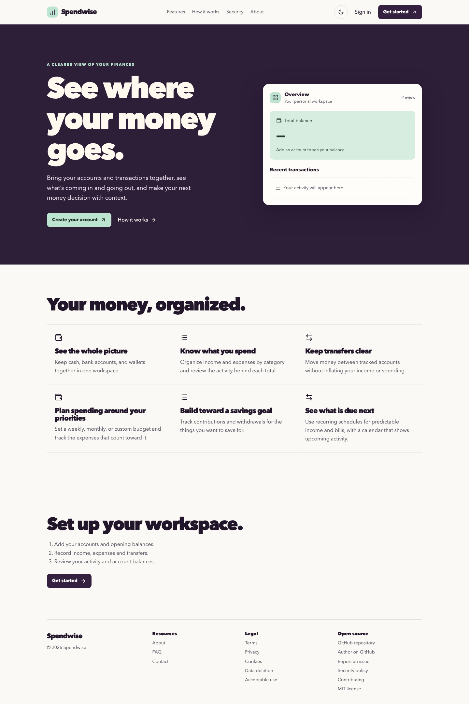
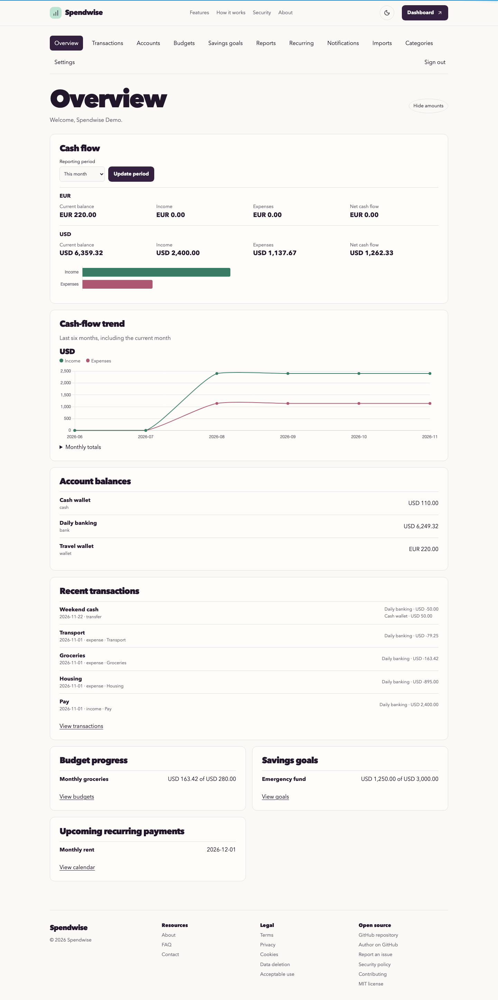
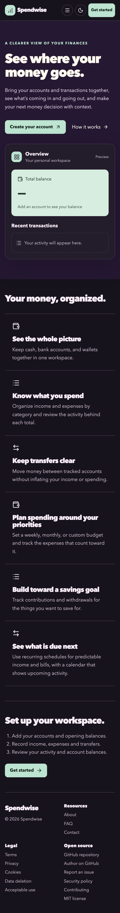

# Spendwise

Spendwise is an open-source personal finance workspace for tracking accounts, income, expenses and transfers.

**Created and maintained by [Princewill](https://github.com/princewill86).**

## Features

- Manual accounts, categories, income, expenses, atomic transfers, reconciliation, and private receipts.
- Six-month cash-flow charts and original-currency balances, budgets, recurring rules, a financial calendar, savings goals, and notifications.
- CSV import previews and duplicate detection, transaction and account exports, and financial reports with charts.
- A personal settings area with optional authenticator-based two-factor authentication, session controls, data export, and deletion requests.
- A platform console for members, website pages and navigation, search metadata, email providers and templates, currencies, feature flags, and administrative audit history and a registration trend chart.

The application uses Laravel 13, Fortify, Vue 3, TypeScript, Inertia, Tailwind CSS, Lucide, Chart.js, and PostgreSQL. See the [architecture](docs/architecture.md) and [operations guide](docs/operations.md).

## Local development

Use PHP 8.4.1 or newer with BCMath and PDO PostgreSQL, Composer 2, Node 22.12 or newer, npm, and PostgreSQL. Docker Compose can run the local database.

```sh
git clone https://github.com/princewill86/spendwise.git
cd spendwise
cp .env.example .env
```

Set a development database password in `.env`, then run:

```sh
docker compose up -d db
composer install
npm ci
php artisan key:generate
php artisan migrate --seed
npm run build
php artisan serve
```

Set `APP_URL` to the actual site URL so signed email verification links point to the running installation. The local mail driver writes messages to the Laravel log. Configure an SMTP provider with `MAIL_MAILER=smtp`, `MAIL_HOST`, `MAIL_PORT`, `MAIL_USERNAME`, `MAIL_PASSWORD`, and a provider-approved sender. Keep mail logs private because development messages can contain signed account links.

The default seeder installs public content, currencies, and email templates. To add an isolated local demonstration account, run `php artisan db:seed --class=DemoSeeder`. It prints a generated password once and requires `APP_ENV=local`.

For recurring rules, budget reminders, and queued email processing, run `php artisan schedule:work` and `php artisan queue:work` in separate terminals. Create the first administrator from an existing verified member with `php artisan spendwise:admin you@example.org`.

## Admin quick start

After granting the administrator role, go to `/admin`. Under **Content**, select **New page**, enter a unique slug, and add the page sections. Save it as a draft or select **Published** to make it available at `/pages/<slug>`. Under **Navigation**, add that path to the public header or footer. Under **SEO**, upload a social sharing image to control the preview image used when sharing public pages. Logo and favicon uploads live under **General**.

## Environment reference

| Variables | Purpose |
| --- | --- |
| `APP_ENV`, `APP_DEBUG`, `APP_URL`, `APP_KEY` | Run mode, debug visibility, public URL for signed links, and application encryption key |
| `DB_CONNECTION`, `DB_HOST`, `DB_PORT`, `DB_DATABASE`, `DB_USERNAME`, `DB_PASSWORD` | PostgreSQL connection settings |
| `SESSION_DRIVER`, `SESSION_LIFETIME`, `SESSION_ENCRYPT`, `SESSION_SECURE_COOKIE` | Session storage, expiration, encryption, and HTTPS cookie behavior |
| `CACHE_STORE`, `QUEUE_CONNECTION` | Cache and job queue backends |
| `MAIL_MAILER`, `MAIL_HOST`, `MAIL_PORT`, `MAIL_USERNAME`, `MAIL_PASSWORD`, `MAIL_FROM_ADDRESS` | Default mail transport configuration |

See [operations](docs/operations.md) for the optional container profile, deployment settings, backups, and background workers.

## Screenshots

<!-- spendwise-screenshots:start -->







<!-- spendwise-screenshots:end -->

See [Capturing README screenshots](CONTRIBUTING.md#capturing-readme-screenshots) for the capture workflow.

## Checks

```sh
php artisan test
vendor/bin/pint --test
npm run lint
npm run typecheck
npm run build
```

PHP tests default to in-memory SQLite. The CI workflow supplies a dedicated PostgreSQL test database. Set PostgreSQL variables in the process environment to exercise the same test suite locally against an empty test database.

Browser checks use Playwright Chromium and write synthetic records. Use a dedicated development or test database. With a seeded development server running, install Chromium with `npx playwright install chromium` and run `SPENDWISE_BROWSER_URL=http://localhost:8000 npm run test:browser`. CI runs these checks against the production asset build.


## Deployment

The [operations guide](docs/operations.md) covers the Docker image, HTTPS, mail configuration, scheduler, queue, PostgreSQL backups, provider quotes, and account deletion.

## Open source

- [Repository](https://github.com/princewill86/spendwise)
- [Contribution guide](CONTRIBUTING.md)
- [Security policy](SECURITY.md)
- [Support](SUPPORT.md)
- [MIT license](LICENSE)
